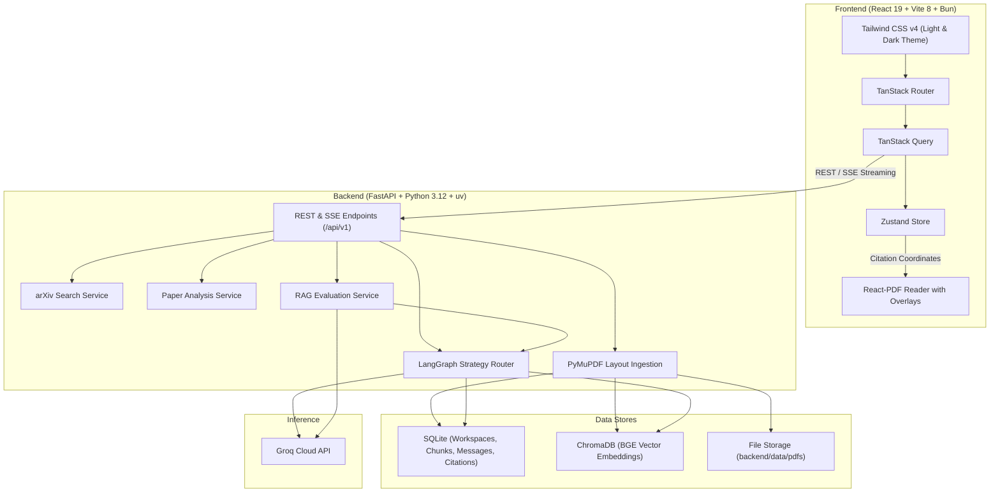
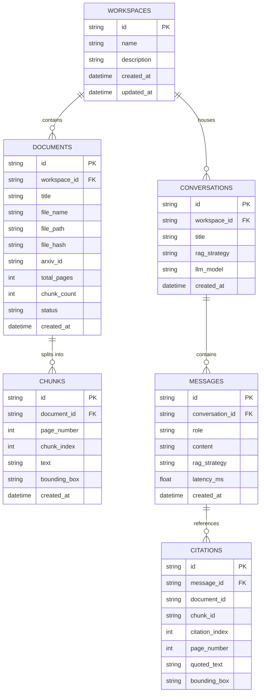

# PaperPilot AI

> Read research papers faster, verify every fact with visual citations, and compare retrieval strategies.

PaperPilot AI is a research assistant designed for students, researchers, and engineers. It lets you upload research papers or import them from arXiv, ask questions across one or multiple documents, and receive grounded answers where every claim links directly to the exact page and highlighted paragraph in the PDF.

---

## The Problem and How PaperPilot Solves It

Academic papers are long, dense, and formatted in complex multi-column layouts. Using general-purpose AI chatbots on papers often causes three main problems:

1. **Hallucination**: The model sounds confident, but invents numbers, misquotes findings, or attributes claims to the wrong paper.
2. **Fake or Broken Citations**: The model cites a page number that does not exist or refers to an unrelated section.
3. **Scrambled PDF Reading**: Basic text extractors read across two columns horizontally, turning paragraphs into mixed-up text.

### How PaperPilot Solves This

- **Layout-Aware PDF Ingestion**: PyMuPDF extracts text blocks in their natural reading order and records exact percentage bounding-box coordinates for every paragraph.
- **Three Specialized RAG Strategies**: Use Basic RAG for fast lookups, HyDE for theoretical questions, or RAG-Fusion to search from multiple angles simultaneously.
- **Visual Citations**: Every answer includes clickable citation badges like `[1]` and `[2]`. Clicking a citation opens the PDF viewer directly to the target page and places a highlight box over the source paragraph so you can verify it yourself.

---

## Core Features

- **Three-Panel Workspace**:
  - **Left Panel**: Document checklist to choose which papers to query, plus sliders for retrieval settings (`top_k`, `rrf_k`).
  - **Center Panel**: Streaming chat interface with markdown formatting, code blocks, LaTeX math, and interactive citation chips.
  - **Right Panel**: On-demand PDF reader with zoom controls, page jumping, and highlighted bounding boxes.
- **Three RAG Strategies**:
  - **Basic RAG**: Direct vector search using 768-dimensional BGE embeddings.
  - **HyDE (Hypothetical Document Embeddings)**: Generates a theoretical academic excerpt to find papers that answer the concept.
  - **RAG-Fusion**: Creates 3 to 4 sub-queries, runs parallel searches, and merges rankings using Reciprocal Rank Fusion ($k=60$).
- **arXiv Search and Import**:
  - Search papers live on arXiv by title, author, category, or arXiv ID.
  - One-click import that automatically downloads the PDF, extracts text and layout coordinates, and indexes it in the vector store.
- **Paper Analysis Tools**:
  - **Structured Summary**: Extracts objectives, methodology, datasets, key results, and limitations.
  - **Cross-Paper Comparison**: Compares multiple papers side-by-side in a structured matrix.
  - **Literature Review**: Synthesizes a literature review draft across selected papers.
- **Strategy Evaluation Lab**:
  - Runs test queries across Basic RAG, HyDE, and RAG-Fusion to benchmark performance.
  - Measures faithfulness, relevance, precision, citation validity, and latency.
- **Interface and Usability**:
  - Clean, distraction-free interface with full dark and light mode support, responsive typography, and dedicated reading panels.

---

## Understanding RAG Evaluation Metrics

PaperPilot includes an evaluation dashboard to help you choose the best retrieval strategy for your workflow:

| Metric | What It Means | Why It Matters |
| :--- | :--- | :--- |
| **Answer Faithfulness** | Checks whether the claims in the answer are strictly supported by the retrieved text chunks. | Protects against hallucination. Guarantees that the assistant does not invent facts or numbers. |
| **Retrieval Relevance** | Measures how closely related the retrieved text chunks are to the user's question. | Ensures the system is finding useful passages rather than random parts of the paper. |
| **Context Precision** | Checks whether the most relevant passages are ranked at the top of the search results. | Keeps important text at rank 1 so the language model focuses on the best evidence first. |
| **Citation Validity** | Verifies that citation tags point to real text and valid PDF coordinates. | Prevents fake or misleading references. |
| **Response Latency** | Measures the time in seconds from question submission to complete answer. | Helps you decide when to use fast Basic RAG versus more thorough RAG-Fusion. |

---

## System Architecture



---

## Database Schema (ERD)



---

## Installation and Setup

### 1. Install Required Tools: uv and bun

PaperPilot uses **uv** for fast Python package management and **bun** for the frontend.

#### Installing uv (Python)
- **Linux and macOS**:
  ```bash
  curl -LsSf https://astral.sh/uv/install.sh | sh
  ```
- **Windows (PowerShell)**:
  ```powershell
  powershell -ExecutionPolicy ByPass -c "irm https://astral.sh/uv/install.ps1 | iex"
  ```
- **Using pip**:
  ```bash
  pip install uv
  ```

#### Installing Bun (JavaScript)
- **Linux and macOS**:
  ```bash
  curl -fsSL https://bun.sh/install | bash
  ```
- **Windows (PowerShell)**:
  ```powershell
  powershell -c "irm bun.sh/install.ps1 | iex"
  ```
- **Using npm**:
  ```bash
  npm install -g bun
  ```

---

### 2. Configure Environment

1. Clone this repository:
   ```bash
   git clone https://github.com/k0msenapati/rag-research-paper-assistant.git
   cd rag-research-paper-assistant
   ```

2. Create a `.env` file in the `backend/` directory:
   ```bash
   touch backend/.env
   ```

3. Add your Groq API key (available for free at [console.groq.com](https://console.groq.com/keys)):
   ```env
   GROQ_API_KEY=gsk_your_groq_api_key_here
   DEFAULT_LLM_MODEL=openai/gpt-oss-120b
   EMBEDDING_MODEL_NAME=BAAI/bge-base-en-v1.5
   ```

---

### 3. Run Backend Server

```bash
cd backend
uv sync                     # Installs dependencies into a local virtual environment
uv run pytest               # Runs test suite (15 tests)
uv run uvicorn app.main:app --host 127.0.0.1 --port 8000 --reload
```
- API will run at: `http://127.0.0.1:8000`
- Interactive API documentation: `http://127.0.0.1:8000/docs`

---

### 4. Run Frontend Application

In a separate terminal:
```bash
cd frontend
bun install                 # Installs dependencies
bun run build               # Runs TypeScript checks and production build
bun run dev                 # Starts Vite development server
```
- Web application will run at: `http://127.0.0.1:5173`

---

## In-Depth Documentation

More detailed guides are available in the `docs/` folder:
- [Setup and Installation Guide](file:///home/kom/projects/rag-research-paper-assistant/docs/SETUP_GUIDE.md): Detailed installation steps, environment variables, and troubleshooting.
- [System Architecture](file:///home/kom/projects/rag-research-paper-assistant/docs/ARCHITECTURE.md): Technical breakdown of ingestion, coordinate normalization, and streaming events.
- [RAG Benchmarks and Evaluation](file:///home/kom/projects/rag-research-paper-assistant/docs/RAG_BENCHMARKS.md): Theory, mathematical formulations, and metric calculation details.
- [Database and ERD Reference](file:///home/kom/projects/rag-research-paper-assistant/docs/DATABASE_ERD.md): Table definitions, constraints, foreign keys, and vector store schema.

---

## Tech Stack

| Component | Technology | Role |
| :--- | :--- | :--- |
| **Backend Framework** | FastAPI (Python 3.12) | Asynchronous REST and Server-Sent Events (SSE) |
| **Package Manager (BE)** | Astral uv | Fast virtual environments and dependency locking |
| **PDF Parser** | PyMuPDF (fitz) | Text block and bounding box extraction |
| **Vector Database** | ChromaDB | Local vector indexing and similarity search |
| **Embeddings** | `BAAI/bge-base-en-v1.5` | Dense vector representation (768 dimensions) |
| **LLM Inference** | Groq Cloud API | Fast token generation (`openai/gpt-oss-120b`) |
| **RAG Workflows** | LangChain / LangGraph | Multi-strategy routing and RRF re-ranking |
| **Frontend Framework** | React 19 + Vite 8 | User interface and build tooling |
| **Runtime (FE)** | Bun | Fast package installation and scripts |
| **Language** | TypeScript 7 | Type safety across API calls, state, and UI |
| **Routing** | TanStack Router | Client-side routing with URL synchronization |
| **Data Fetching** | TanStack Query v5 | Server state caching and refetching |
| **State Management** | Zustand | Global UI state (active paper, citations, viewer) |
| **Styling** | Tailwind CSS v4 | CSS utility tokens with dark and light themes |
| **PDF Viewer** | React-PDF | Canvas-based PDF viewer with custom highlight boxes |

---

## Verification and Testing

To verify the setup:

```bash
# Backend tests
cd backend && uv run pytest

# Frontend build and lint
cd ../frontend && bun run lint && bun run build
```

---

## License

Licensed under the [MIT License](file:///home/kom/projects/rag-research-paper-assistant/LICENSE).
