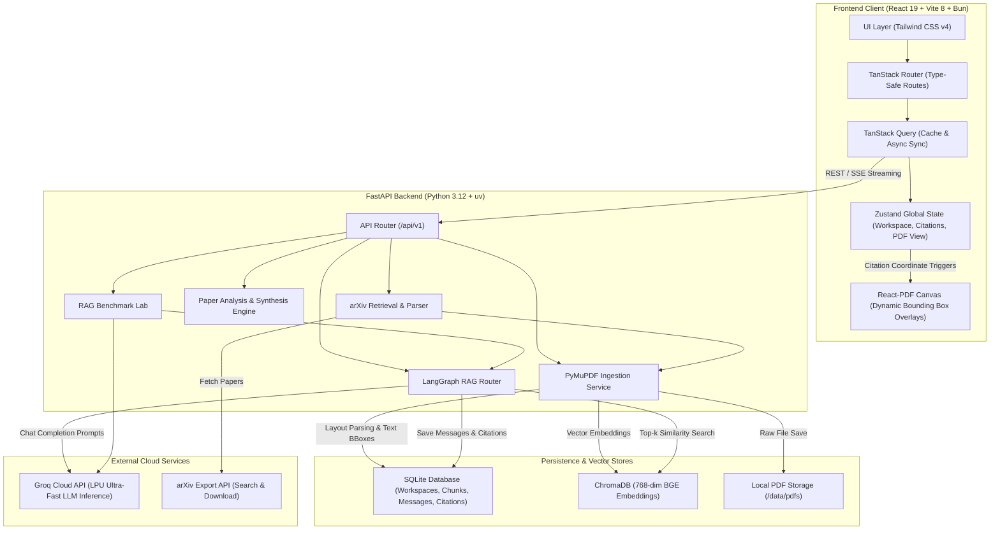
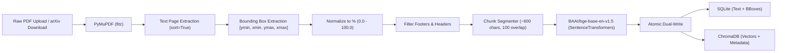
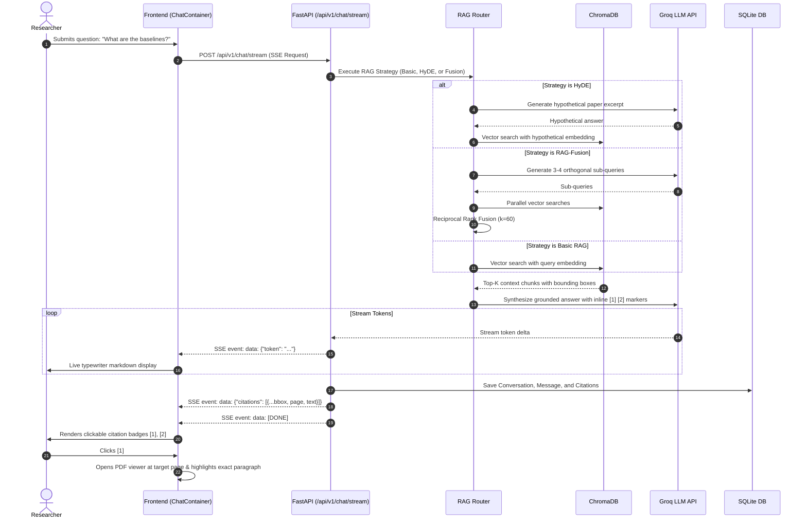

# PaperPilot AI — System Architecture & Data Flow

This document details the architectural design, ingestion pipeline, multi-strategy RAG execution graph, and citation coordinate rendering mechanics.

---

## 1. System Architecture Overview



---

## 2. Document Ingestion Pipeline

Academic papers are notorious for challenging multi-column layouts, header/footer noise, equations, and tables. PaperPilot AI handles this with a dedicated ingestion pipeline:



### Bounding Box Percentage Coordinates
To render highlights seamlessly across any screen resolution and responsive zoom level, coordinates are extracted from PyMuPDF and normalized into percentages:

$$\text{ymin}\% = \frac{y_0}{\text{page\_height}} \times 100, \quad \text{xmin}\% = \frac{x_0}{\text{page\_width}} \times 100$$
$$\text{height}\% = \frac{y_1 - y_0}{\text{page\_height}} \times 100, \quad \text{width}\% = \frac{x_1 - x_0}{\text{page\_width}} \times 100$$

When the user clicks citation `[1]`, the frontend renders a high-contrast glowing overlay:
```tsx
<div
  className="absolute border-2 border-[#e06c38] bg-[#e06c38]/20 rounded transition-all animate-pulse pointer-events-none"
  style={{
    top: `${ymin}%`,
    left: `${xmin}%`,
    width: `${width}%`,
    height: `${height}%`,
  }}
/>
```

---

## 3. Streaming Chat & Citation Linking Sequence

The conversation view streams tokens live via Server-Sent Events (SSE), delivering an interactive typewriter experience while simultaneously resolving structured citations:



---

## 4. Frontend State & Component Hierarchy

- **Global Store (`useWorkspaceStore`)**:
  - `activeWorkspaceId`: Scopes all document queries, conversations, and benchmarks.
  - `selectedDocumentIds`: Multi-select paper filter for scoped RAG queries.
  - `activeRagStrategy`: `'basic' | 'hyde' | 'fusion'`.
  - `selectedModel`: LLM model identifier (e.g. `openai/gpt-oss-120b`).
  - `pdfViewerOpen`: Controls responsive side-by-side split screen.
  - `activeCitation`: Holds target page, bounding box coordinates, and quoted snippet.
- **Theme Store (`useThemeStore`)**:
  - Manages dark/light theme switching with instant DOM synchronization and persistent local storage.
- **TanStack Router**:
  - `/`: Overview Dashboard (stats, quick actions, workspace manager).
  - `/workspaces/$workspaceId`: 3-panel chat cockpit & synchronized PDF reader.
  - `/workspaces/$workspaceId/library`: Ingested paper manager & chunk inspector.
  - `/workspaces/$workspaceId/arxiv`: Live arXiv search & 1-click paper ingestion.
  - `/workspaces/$workspaceId/analysis`: Paper summarization, comparative matrix, and literature review.
  - `/workspaces/$workspaceId/evaluation`: RAG strategy benchmark lab.
