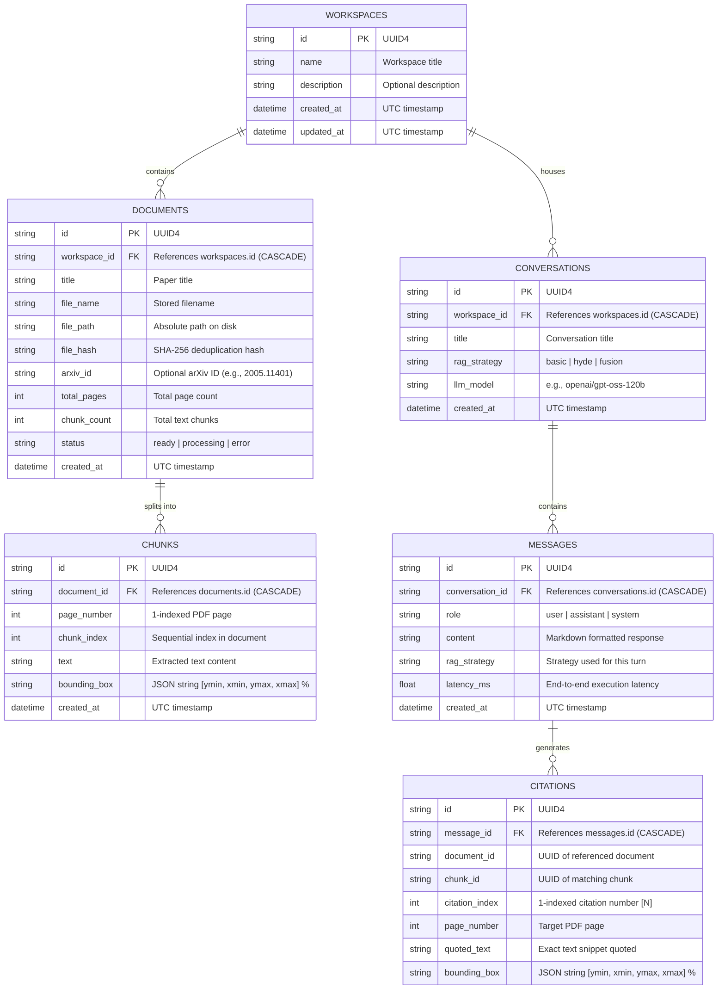

# Database Schema & Entity Relationship Diagram (ERD)

PaperPilot AI utilizes a dual-layer persistence architecture:
1. **Relational Layer (SQLite + SQLAlchemy 2.0)**: Manages relational workspaces, document metadata, chunk text, conversations, streaming chat messages, and citation coordinates.
2. **Vector Layer (ChromaDB)**: Stores 768-dimensional dense vector embeddings generated by `BAAI/bge-base-en-v1.5` with document and page metadata filtering.

---

## 1. Entity Relationship Diagram (ERD)



---

## 2. Table Specifications

### `workspaces`
The root logical container for research projects, grouping isolated sets of papers, conversations, and benchmarks.
- `id`: `String(36)`, Primary Key.
- `name`: `String(255)`, Not Null.
- `description`: `Text`, Nullable.
- `created_at` / `updated_at`: `DateTime(timezone=True)`.

### `documents`
Academic papers ingested from PDF files or arXiv.
- `id`: `String(36)`, Primary Key.
- `workspace_id`: Foreign Key to `workspaces.id` with `ON DELETE CASCADE`.
- `title`: `String(500)`. Extracted from PDF metadata or arXiv API title.
- `file_path`: `Text`. Full path to stored PDF in `backend/data/pdfs/`.
- `file_hash`: `String(64)`, Indexed. SHA-256 hash preventing duplicate file uploads.
- `arxiv_id`: `String(64)`. Nullable (e.g. `"2005.11401"`).
- `status`: `String(32)`. Current state (`processing`, `ready`, `failed`).

### `chunks`
Extracted textual blocks from PDF pages with bounding box coordinates.
- `id`: `String(36)`, Primary Key.
- `document_id`: Foreign Key to `documents.id` with `ON DELETE CASCADE`.
- `page_number`: `Integer`. 1-based page number.
- `chunk_index`: `Integer`.
- `text`: `Text`. Extracted text passage.
- `bounding_box`: `Text`. Normalized bounding box percentages: `"[ymin, xmin, ymax, xmax]"` (from $0.0$ to $100.0$).

### `conversations`
Persistent chat threads within a workspace.
- `id`: `String(36)`, Primary Key.
- `workspace_id`: Foreign Key to `workspaces.id` with `ON DELETE CASCADE`.
- `title`: `String(255)`. Auto-generated from user's first query.
- `rag_strategy`: `String(32)`. Strategy used (`basic`, `hyde`, `fusion`).
- `llm_model`: `String(128)`. LLM model name used.

### `messages`
Individual turns in a conversation.
- `id`: `String(36)`, Primary Key.
- `conversation_id`: Foreign Key to `conversations.id` with `ON DELETE CASCADE`.
- `role`: `String(16)`. (`user` or `assistant`).
- `content`: `Text`. Markdown text with inline citation tokens `[1]`, `[2]`.
- `latency_ms`: `Float`. Processing duration in milliseconds.

### `citations`
Verifiable references linking an assistant statement to an exact physical PDF location.
- `id`: `String(36)`, Primary Key.
- `message_id`: Foreign Key to `messages.id` with `ON DELETE CASCADE`.
- `citation_index`: `Integer`. Ordinal badge number in the message text.
- `page_number`: `Integer`. Target page in the PDF reader.
- `quoted_text`: `Text`. Snippet displayed in the reader citation callout card.
- `bounding_box`: `Text`. Percentage coordinates for the glowing canvas overlay.

---

## 3. ChromaDB Vector Store Schema

- **Collection Name**: `paperpilot_chunks`
- **Embedding Dimensions**: `768` (`BAAI/bge-base-en-v1.5`)
- **Distance Metric**: Cosine Distance
- **Metadata Fields**:
  ```json
  {
    "document_id": "string",
    "page_number": 1,
    "chunk_index": 0,
    "bounding_box": "[12.4, 8.5, 24.1, 91.2]",
    "file_name": "rag_paper.pdf",
    "title": "Retrieval-Augmented Generation for Knowledge-Intensive NLP Tasks"
  }
  ```

---

## 4. Storage Directory Layout

```
backend/data/
├── paperpilot.db       # SQLite relational database
├── chromadb/           # ChromaDB vector index and binary persistent storage
│   ├── chroma.sqlite3
│   └── ...
└── pdfs/               # Raw academic PDFs saved by UUID
    ├── 2005.11401.pdf
    └── 7532f56b-6a9e-4ef6-86b1-11cdd7dcf84c.pdf
```
